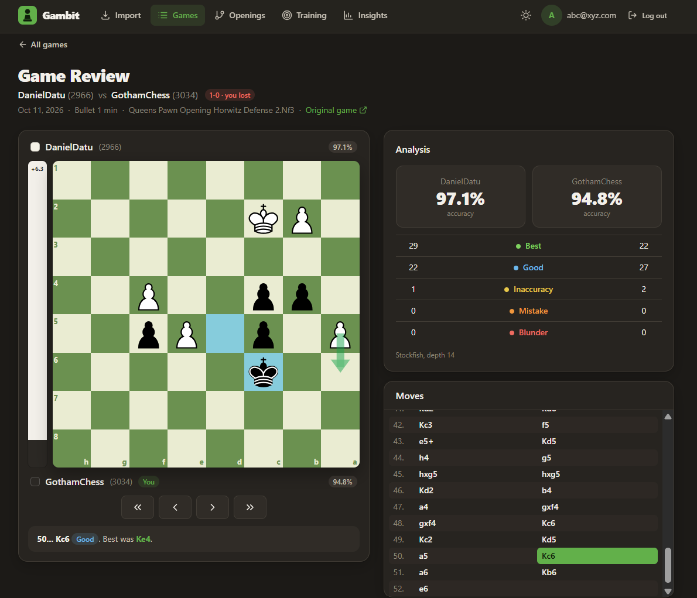
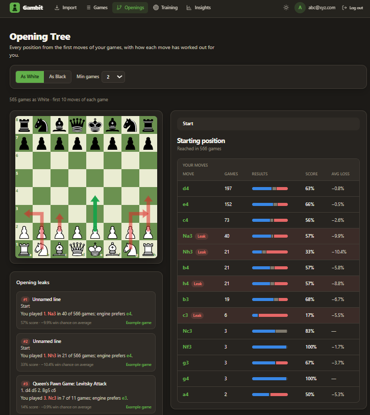
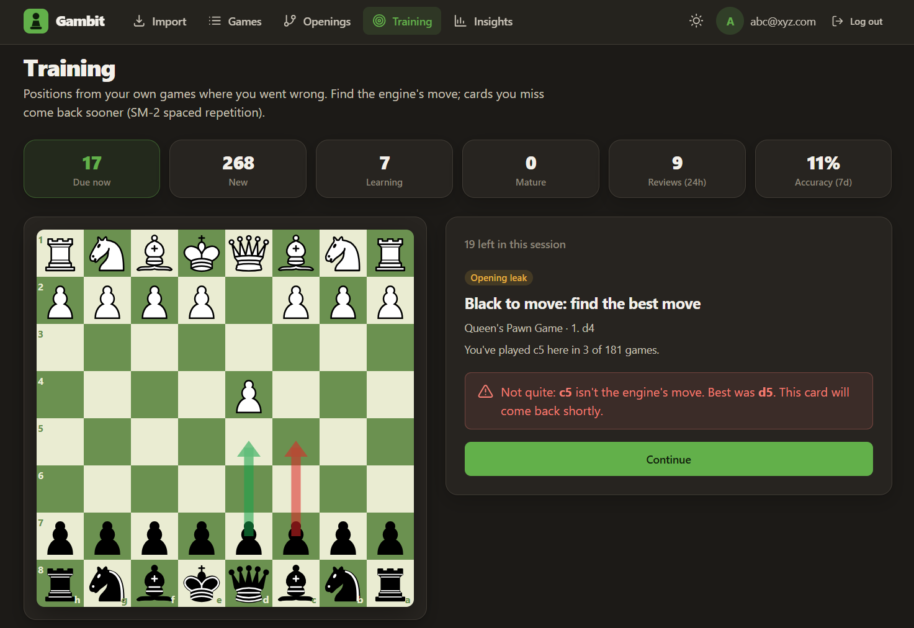
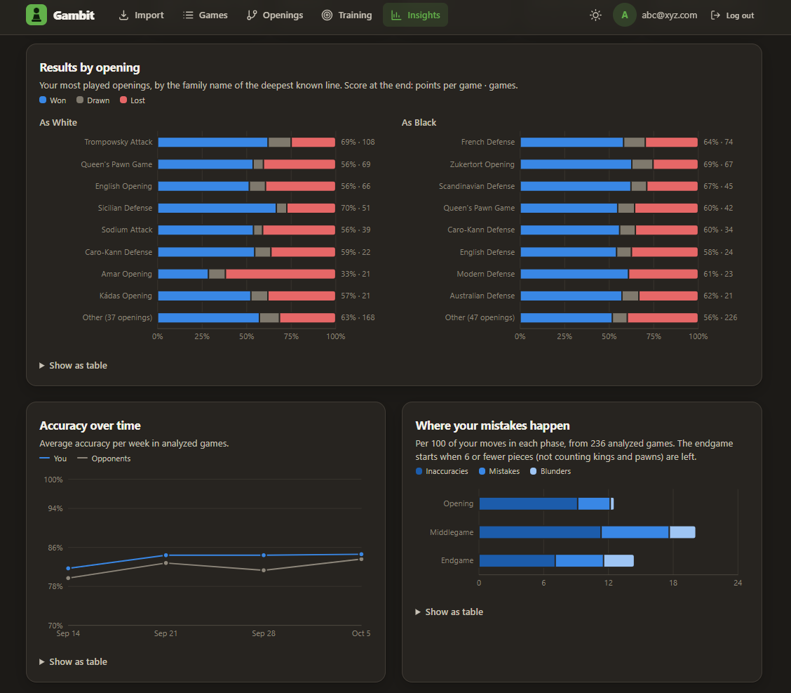
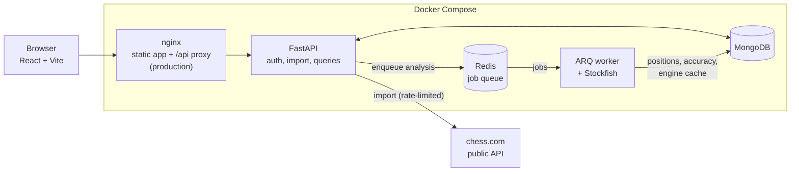
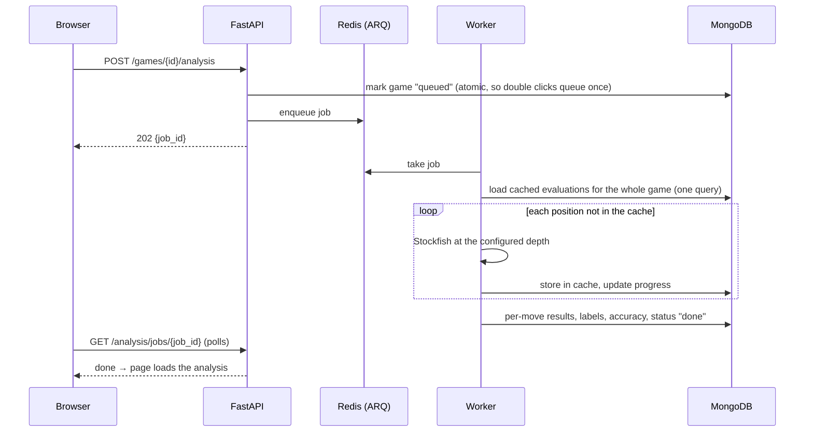

# Gambit

Gambit imports your chess.com games, analyzes every move with Stockfish, finds the opening lines and positions where you keep losing points, and drills those exact positions with spaced repetition.

Built with FastAPI, React, MongoDB, Redis and Stockfish. Personal portfolio project; the full brief is in [`gambit-spec.md`](gambit-spec.md).

<!-- Screenshots: save PNGs under docs/screenshots/ with these names. -->
| Game review | Opening tree |
| --- | --- |
|  |  |
| **Training** | **Insights** |
|  |  |

## What it does

- **Import:** pick months from a chess.com account; games are fetched from the public API, parsed, and stored once each.
- **Analyze:** each game is analyzed in the background. Every move gets an evaluation, the engine's best move, and a label (best, good, inaccuracy, mistake, blunder); each side gets an accuracy score.
- **Review:** step through a game with an evaluation bar, move labels, and the engine's suggestion drawn on the board.
- **Opening tree:** all your games merged into one tree of positions, with your score and average loss for each move, where you leave known theory, and a ranked list of **leaks**: positions you keep reaching and keep getting wrong.
- **Training:** your blunders and opening leaks become cards. Play the right move, rate how hard it was, and SM-2 decides when you see it again.
- **Insights:** results by opening and color, accuracy over time, where in the game your mistakes happen, and results by time of day.
- **Themes:** dark by default, with a light theme that follows your OS setting and a toggle in the header. Every color comes from a small set of design tokens, and the chart palettes are checked for color-blind separation and contrast in both themes.

## Architecture



An analysis request never waits for the engine:



| Collection | Holds |
| --- | --- |
| `users` | email, bcrypt hash, chess.com username |
| `games` | PGN, players, result from the user's side, opening, analysis status, progress and accuracy |
| `positions` | one per analyzed move: FEN, move played, engine's best move, evaluations before and after, label, phase |
| `analysis_cache` | engine result per (position, depth); unique index |
| `opening_moves` | the first 20 plies of every game, keyed by position, with analysis copied on |
| `training_cards`, `training_reviews` | cards with their SM-2 schedule; one log entry per review |

## Design decisions

**Analysis runs in a worker, never in a request.** A game takes 2–13 s to analyze at depth 14, too long for an HTTP request. The API marks the game queued and enqueues an ARQ job; the worker keeps one Stockfish process alive and runs one job at a time, and more workers scale it out (`--scale worker=3`). Job status lives on the game document, so the page can resume polling after a reload and ownership checks need no extra lookup.

**Moves are judged by lost win chance, not centipawns.** Evaluations are turned into a win chance with Lichess's logistic curve, and a move's label depends on how much win chance it gave away (5 / 10 / 20 points for inaccuracy / mistake / blunder; configurable). Losing a pawn's worth in an equal position is serious; doing it when already a rook up barely matters, and centipawn thresholds can't tell the two apart.

**Accuracy uses Lichess's method.** A plain average of move accuracies came out at 85–97% for almost every game, because most moves are easy. Gambit now combines a volatility-weighted mean (moves in sharp positions count more) with a harmonic mean (a few bad moves pull it down), as Lichess does.

**Engine results are cached by position, not by game.** The cache key is the FEN without move counters plus the depth, so the same position reached in another game, or by another move order, is never sent to Stockfish twice. A whole game's cached positions are loaded in one query before analysis starts (see the results below for what that changed).

**The opening tree is one aggregation, with no joins.** The first 20 plies of each game are indexed by position, and engine results are copied onto those records when analysis finishes. Building the tree is then a two-stage `$group` (once per game, then per position and move). Indexing is lazy: the endpoint indexes any new games first.

**Leaks need repetition and evidence.** A leak is a position reached at least 3 times where you played the same move at least twice and either scored 35% or less with it or lost 8+ points of win chance on average. Lost games count against every later move in the same line, so a results-only leak is dropped when an earlier move on its path already explains those games; otherwise one bad line shows up as a chain of leaks.

**Spaced repetition is SM-2 with two practical changes.** A failed card comes back after 10 minutes instead of tomorrow, and at most 20 new cards start per day, so analyzing 100 games doesn't bury the reviews that are due.

**Insights share one filter.** Every chart is a MongoDB aggregation over the same game filter (time control, start date), so the numbers on the page always agree. Weeks, months and hours are computed in the viewer's time zone. Daily games are left out of time-of-day stats, because their end time says nothing about when they were played.

**Tests use fakes where they can and the real thing where they must.** Most backend tests run against an in-memory MongoDB and a scripted engine, so they're fast and need nothing installed. Tests that need real Stockfish or real MongoDB features (time zones in `$dateToString`) run against the real thing and skip locally when it's missing; CI sets `GAMBIT_REQUIRE_INTEGRATION=1` so they fail there instead of skipping. Frontend tests can never reach a real server.

**Security.** Passwords are hashed with bcrypt; sessions are HS256 JWTs, and the API refuses to start in production with the default or a short secret. In production the browser talks to one origin (nginx proxies `/api`), so no CORS is needed. The token is kept in `localStorage`, which is simple but readable by any script on the page; an httpOnly cookie with CSRF protection would be the next step for a public deployment.

## Measured results

### Analysis speed

30 real games (2,029 moves) from one public chess.com account, analyzed by the production code path: Stockfish through python-chess with 1 thread and 64 MB hash, results cached in MongoDB. Machine: 13th Gen Intel i5-13420H (Docker, one worker). Reproduce with `docker compose run --rm worker python -m benchmarks.analysis_benchmark --depths 10 14 18`.

| Depth | Per game, empty cache (mean) | median | p95 | Per engine call | Per game, warm cache |
| ---: | ---: | ---: | ---: | ---: | ---: |
| 10 | 1.09 s | 0.95 s | 1.96 s | 16 ms | 0.018 s |
| 14 (default) | 7.21 s | 7.13 s | 13.64 s | 115 ms | 0.018 s |
| 18 | 36.80 s | 35.61 s | 62.36 s | 592 ms | 0.018 s |

- **Depth is the cost.** Each step up in depth multiplies the engine's time per position by roughly 5–7×, so depth 14 is the default: about 7 s for a typical game, against 37 s at depth 18.
- **Cache hit rate.** Starting from an empty cache, 10% of positions were already cached by an earlier game in the set; the rest went to Stockfish. These games are unrelated and mostly long, so they share little beyond their first few moves. Analyzing the same games again hit the cache for 100% of positions. In real use the rate climbs as the cache fills, since every position is stored once per depth.
- **Warm cache.** Re-analyzing an already analyzed game takes 18 ms at any depth, which is only database lookups and scoring.
- **What batching the cache lookups changed.** The first version looked positions up one query at a time; analysis now loads a whole game's cached positions in one query. Warm-cache time fell from 59–77 ms to 18 ms per game (3.3–4.3×). Empty-cache times are unchanged: the two runs differ by +6% to −7%, which is run-to-run noise, because Stockfish dominates there. I'm reporting that as measured rather than as an improvement.

### Other measurements

From development, on the same machine with real games:

| Measure | Result |
| --- | --- |
| Backend tests | 210 (pytest), including real Stockfish and MongoDB; none skipped in Docker or CI |
| Frontend tests | 95 (Vitest + React Testing Library) |
| Insights endpoints, 47 games | 15–30 ms each |
| Opening tree, 77 games | 0.29 s first request (indexes the games), 0.02 s after |
| JavaScript downloaded on first load | 292 KB (93 KB gzipped); charts and the chessboard load with their pages |

## Running it

### Development

```bash
docker compose up --build
```

- App: http://localhost:5173
- API: http://localhost:8000 (interactive docs at `/docs`)

Code changes reload automatically in the API, worker and frontend containers.

### Tests

```bash
# Backend (Python 3.11+)
cd backend
python -m venv .venv
source .venv/bin/activate          # Windows: .venv\Scripts\activate
pip install -r requirements-dev.txt
pytest

# Everything, including the Stockfish tests, inside the worker image
docker compose run --rm worker sh -c "pip install -q -r requirements-dev.txt && pytest"

# Frontend
cd frontend
npm ci
npm test
```

### Benchmarks

```bash
docker compose run --rm worker python -m benchmarks.analysis_benchmark --depths 10 14 18
```

Results are written to `backend/benchmarks/results.md` and `results.json`.

### Production

```bash
cp .env.example .env               # set JWT_SECRET (openssl rand -hex 32)
docker compose -f docker-compose.prod.yml up -d --build
```

nginx serves the built app and proxies `/api` on port `WEB_PORT` (default 80). MongoDB and Redis are only reachable inside the Compose network, and Redis keeps the job queue on disk. Put a TLS-terminating proxy or load balancer in front for HTTPS. Existing analyses can be re-scored after a change to the accuracy formula with `docker compose exec api python -m scripts.recompute_accuracy`.

### Configuration

All settings are environment variables (see `backend/app/config.py`).

| Variable | Default | Meaning |
| --- | --- | --- |
| `JWT_SECRET` | dev-only value | Signing key; required in production (32+ characters) |
| `ENVIRONMENT` | `development` | `production` enables the secret check |
| `ANALYSIS_DEPTH` | 14 | Stockfish depth per position |
| `INACCURACY_THRESHOLD` / `MISTAKE_THRESHOLD` / `BLUNDER_THRESHOLD` | 5 / 10 / 20 | Win-chance loss (percentage points) for each label |
| `OPENING_PLIES` | 20 | How much of each game the opening tree covers |
| `LEAK_MIN_OCCURRENCES`, `LEAK_MIN_MOVE_GAMES`, `LEAK_MAX_SCORE`, `LEAK_MIN_EVAL_LOSS` | 3, 2, 0.35, 8 | Leak rules |
| `TRAINING_NEW_CARDS_PER_DAY` | 20 | New training cards started per 24 hours |
| `CHESSCOM_REQUEST_DELAY_SECONDS` | 1.0 | Minimum gap between chess.com requests |
| `MONGO_URL`, `MONGO_DB`, `REDIS_URL`, `STOCKFISH_PATH` | local defaults | Connections |
| `CORS_ORIGINS` | `["http://localhost:5173"]` | Browser origins allowed to call the API (JSON list; `[]` in production, where nginx serves both from one origin) |
| `ACCESS_TOKEN_EXPIRE_MINUTES`, `JWT_ALGORITHM` | 1440, `HS256` | Session length (24 h) and token signing algorithm |
| `ENGINE_THREADS`, `ENGINE_HASH_MB` | 1, 64 | Stockfish threads and hash size per worker |
| `CHESSCOM_USER_AGENT` | `Gambit/0.1 (…)` | User-Agent sent to chess.com; set it to something that identifies you |

## API

Interactive docs at `/docs` when the API is running. All routes except signup, login and health need `Authorization: Bearer <token>`.

| Method | Path | Description |
| --- | --- | --- |
| GET | `/health` | MongoDB and Redis status |
| POST | `/auth/signup`, `/auth/login` | Create an account / log in; both return a JWT and the user |
| GET | `/auth/me` | The current user |
| GET | `/games/import/months?username=` | Months with games on chess.com, newest first |
| POST | `/games/import` | Import one month (`{username, year, month}`) |
| GET | `/games` | Your games, newest first; filters `result`, `color`, `time_class`, `opening`; paging `limit`, `offset` |
| GET | `/games/{id}` | One game with its PGN |
| POST | `/games/{id}/analysis` | Queue analysis; returns the job (or the existing one if already queued or running) |
| POST | `/analysis/queue-all` | Queue every game not yet analyzed |
| GET | `/analysis/jobs/{job_id}` | Job status and progress |
| GET | `/games/{id}/analysis` | Per-move evaluations, labels and accuracy |
| GET | `/openings?color=white&min_games=2` | Opening tree for one color and ranked leaks |
| POST | `/training/sync` | Create cards from new blunders and leaks |
| GET | `/training/due` | Reviews due, then new cards within today's allowance |
| POST | `/training/cards/{id}/review` | Submit a move and a rating (`again` / `hard` / `good` / `easy`) |
| GET | `/training/stats` | Card counts, recent reviews and accuracy |
| GET | `/insights/summary`, `/openings`, `/accuracy`, `/mistakes`, `/time-of-day` | Dashboard data; all take `time_class`, `since` and `tz` |

## Project layout

```
backend/
  app/
    auth/       signup, login, JWT, current user
    games/      chess.com client, PGN parsing, import and listing
    analysis/   Stockfish wrapper and cache, analyzer, scoring, phases, jobs, queue
    openings/   opening book, position index, tree and leak finder
    training/   card generation, SM-2, review endpoints
    insights/   aggregation pipelines
    models/     Pydantic request and response models
  worker.py     ARQ worker entrypoint
  benchmarks/   analysis benchmark, its games and results
  scripts/      one-off maintenance (recompute accuracy)
  tests/
frontend/
  src/pages/        one component per route
  src/components/   board, charts, tables, forms
  src/hooks/        data loading, analysis polling, training session
  src/api/          fetch wrappers
docker-compose.yml       development
docker-compose.prod.yml  production
.github/workflows/ci.yml backend, frontend and Docker builds
```

## Future work

- Accept moves that are as good as the engine's top move in training (needs the engine to check alternatives, e.g. MultiPV when cards are created).
- Move the session token to an httpOnly cookie with CSRF protection.
- A promotion picker on the training board (pawns currently always promote to a queen).

## Data and licenses

Game data comes from the [chess.com published-data API](https://www.chess.com/news/view/published-data-api) (public games only). Opening names come from the [Lichess openings dataset](https://github.com/lichess-org/chess-openings) (CC0). Stockfish (GPLv3) is installed into the Docker image from Debian's package; it isn't part of this repository.
